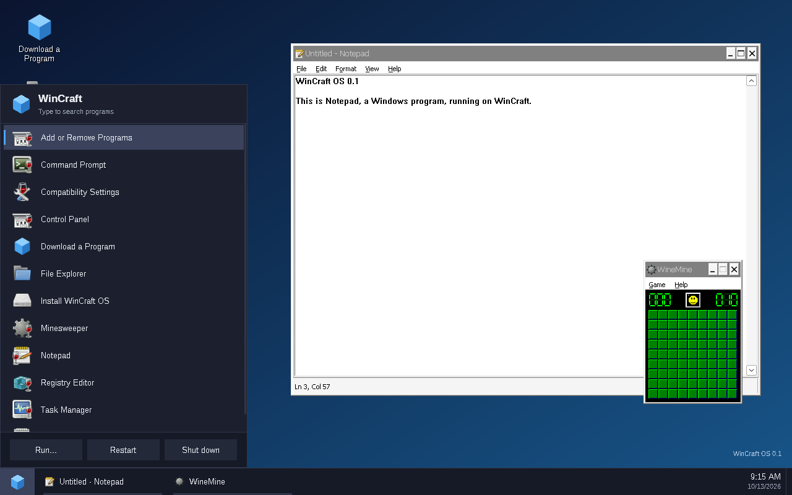

# WinCraft OS

A small, open-source operating system whose native application format is the
Windows program. It boots straight into a Windows-style desktop; `.exe` and
`.msi` files run when you open them, installers put their shortcuts in the
Start menu, and there is nothing else on the disk.

- **269 MB** ISO, boots on BIOS and UEFI
- about **80 MB of RAM** in use at the idle desktop
- runs live from the ISO, or installs to disk in under a minute
- 64-bit and 32-bit Windows programs
- **WinCraft Assistant**, built in: it knows WinCraft, looks at this computer
  to answer, and asks before it changes anything, using an AI model you
  choose (optional)
- **WinCraft Agent**: when WinCraft lacks something, such as a keyboard
  layout that stays, the assistant hands the task over, and the agent builds
  the missing piece for this computer as a *feature*, as administrator in a
  sandbox, after you approve its plan and its result

**Status: 0.7.18, a working preview.** Read [What it is not](#what-it-is-not)
before relying on it.



## Download

Get `wincraft-0.7.18-x86_64.iso` from the [releases page](../../releases) and
check it against the `.sha256` file published next to it:

```sh
sha256sum -c wincraft-0.7.18-x86_64.iso.sha256
```

Then boot it in a virtual machine. This is the configuration it was tested
with (4 GB of RAM, 4 CPUs):

```sh
qemu-system-x86_64 -machine q35 -accel kvm -cpu host -m 4096 -smp 4 \
    -device VGA -device qemu-xhci -device usb-tablet -device usb-kbd \
    -nic user,model=virtio-net-pci -cdrom wincraft-0.7.18-x86_64.iso
```

To share the clipboard (text, both ways) with the VM, add QEMU's clipboard
channel and turn it on in its window:

```sh
    -chardev qemu-vdagent,id=vda,clipboard=on -device virtio-serial-pci \
    -device virtserialport,chardev=vda,name=com.redhat.spice.0 -display gtk,clipboard=on
```

Guest drivers for VirtualBox, VMware and Hyper-V are built into the kernel,
but only QEMU has been tried. Nothing touches your disks unless you run
*Install WinCraft OS* from the desktop.

## How it works

WinCraft does not reimplement Windows. It combines the two open-source
projects that already do the hard parts, and writes everything in between:

| Layer | What | Origin |
|---|---|---|
| Kernel | Linux 6.18 LTS, one monolithic image, no modules, no firmware blobs. Built with NT synchronisation primitives (`ntsync`) and with PE executables registered as a native binary format | built from source, config in `kernel/` |
| Windows API | Wine 11 (WoW64 build: 64- and 32-bit programs), with Wine Mono for .NET programs | binary packages, plus the fixes in `wine/patches` |
| Display | X.Org server, Mesa (software OpenGL) | binary packages |
| **Init** | `wcinit`: PID 1, service supervision, shutdown, a small privilege broker | **written for WinCraft** (`src/init`) |
| **Window manager** | `wcwm`: stacking layers, focus, minimise/maximise, work area. Draws nothing: Windows programs frame their own windows | **written for WinCraft** (`src/wm`) |
| **Shell** | `wcshell.exe`: desktop, taskbar, Start menu with search, Run, *Download a Program*, installer front end. A native Win32 program | **written for WinCraft** (`src/shell`) |
| **Assistant and Agent** | `wcagent.exe`: *WinCraft Assistant*, a chat about WinCraft and this computer with the AI model you choose, and *WinCraft Agent*, which builds features for this computer in a sandbox. A native Win32 program | **written for WinCraft** (`src/agent`) |
| **Boot, install, build** | early userspace, live/installed boot, disk installer, image assembler | **written for WinCraft** |

The userland is not a Linux distribution with a desktop on top. The build
takes binary packages from Arch Linux, then copies out only the files the
system needs (`tools/assemble-rootfs.py`), verifying that every shared-library
dependency still resolves. There is no package manager, no systemd, no shell
you ever have to see.

The system is one read-only, compressed image (`wincraft/system.sfs`) with a
writable layer on top: RAM for a live session, a data partition once
installed. An update is a new image file; your programs and files live in the
other layer.

## What works (tested)

Verified in QEMU, booting the ISO, unless noted:

- Boot via Limine on **BIOS** and on **UEFI** (OVMF), to the desktop.
- Desktop shell: Start menu with type-to-search, taskbar with running
  windows, minimise / maximise / restore, drag, Run dialog (Win+R), context
  menus, Windows key, clock, Alt+Tab, programs' notification-area icons
  (with their tooltips, balloons and menus, for 32- and 64-bit programs) in
  the taskbar beside the clock. Programs set to start with Windows (the Run
  keys and the Startup folder) start at login, once the taskbar is there.
  A program that installs several shortcuts in its own folder gets one
  folder entry in the Start menu, which opens in place; search still finds
  what is inside.
- The desktop and taskbar follow Windows' own settings for a desktop picture
  or colour, a light taskbar, the accent colour, seconds on the clock and
  focus following the mouse, and three of WinCraft's own (one-click icons, a
  taskbar that hides itself, the taskbar at the top), all in the registry
  and applied at once. The assistant changes them for you; the list, with
  the keys, is in its guide (`src/agent/knowledge/troubleshooting.md`,
  "WinCraft's desktop and taskbar").
- Networking: wired, DHCP, DNS; HTTPS with certificate validation.
- **The clock follows internet time**: the `time` service runs `ntpd`
  against four `pool.ntp.org` servers once the network is up, and corrects
  a clock that is wrong.
- **Install to disk**, boot from the installed disk (BIOS and UEFI), files
  persisting across reboots. After the installation the computer starts the
  disk even with the installation ISO still attached.
- Shut down and restart from the Start menu.
- Third-party software (tested in the native desktop session, `./wc desktop`):
  the **7-Zip** installer downloaded with *Download a Program*, installed,
  appeared in the Start menu and ran; both the 64-bit and the 32-bit builds.
- **Firefox 158**, downloaded and installed with *Download a Program* in a
  live session with 8 GB of RAM: browsing works and YouTube plays video.
- **Clipboard shared with QEMU** (`./wc run`'s window): text copied on the
  host pastes into Windows programs in the VM and back, including non-ASCII
  text and texts over 10 KB; it keeps working when the desktop session
  restarts. Also from a Wayland desktop, into an installed system.
- **WinCraft Assistant**, with a real model (Claude Sonnet 5.5 through
  Anthropic's API): setup, chats that look things up on the computer and,
  when allowed, on the web; installing VLC, PuTTY and KeePass from their
  official download pages; a link in an answer opening in Firefox. Against a
  scripted test server speaking both API formats: every tool, every
  permission dialog (allow and refuse), stopping a request, errors.
- **WinCraft Agent**, with Claude Sonnet 5.5, on an installed system: asked
  to keep the French keyboard layout, the assistant named what WinCraft
  lacks and handed the task over; the agent studied how WinCraft applies
  `wc.kbd=`, built and tested a feature in its sandbox (a setting and a boot
  hook), and after both approvals the layout was French after a restart.
  Against the scripted test server: the sandbox's limits, refusing the plan
  or the result, a second hand-over while one runs, an agent that is killed.
- **Features**: every extension point, hooks that fail or hang, a feature
  that root does not own (refused), disabling and removing in *WinCraft
  Features*, and the boot menu's *without your features* entry.
- **.NET programs**: KeePass 2.61 (.NET Framework, Windows Forms) runs on
  the built-in Wine Mono with nothing to install. ILSpy 11 (.NET 10) asks for
  Microsoft's .NET Desktop Runtime; after its installer, ILSpy runs and
  decompiles.
- **3D and sound in a virtual machine**: SuperTuxKart 1.5, installed by
  WinCraft Assistant from the official release, plays in `./wc run`'s window
  with OpenGL 4.3 drawn by the host's graphics card (virgl on an AMD Radeon),
  and its sound plays through QEMU's Intel HD Audio on the host's speakers
  (PipeWire).

## What it is not

Be clear-eyed about these before you depend on it:

- **It does not run "anything Windows runs".** Compatibility is Wine's.
  Most desktop applications and a large share of games work; kernel drivers,
  kernel-level anti-cheat and DRM, UWP/Store apps and some copy protection do
  not. Check a program at <https://appdb.winehq.org>.
- **Little GPU acceleration.** In a virtual machine with a virtio GPU and
  virgl, as `./wc run` starts it, the guest's OpenGL (which Wine also uses for
  Direct3D) runs on the host's graphics card; SuperTuxKart plays well. On
  real hardware everything tested so far is software-rendered (OpenGL
  through llvmpipe): fine for applications, far too slow for modern 3D games.
  Intel graphics have a kernel driver and may be accelerated, but that is
  untested; AMD and NVIDIA cards run unaccelerated on the firmware
  framebuffer. There is no Vulkan (so no Direct3D 12).
- **No Wi-Fi, no Bluetooth.** Both need firmware blobs and supporting
  services that are not in the image. Wired Ethernet only.
- **No web browser included.** Use *Download a Program* → *Get Firefox*, and
  give a live session 8 GB of RAM for it: 4 GB is not enough.
- **No media codecs** (Media Foundation / DirectShow playback), no printing.
- **.NET is partly covered.** Wine Mono, built in, stands in for the .NET
  Framework, but not for all of it. Programs for .NET 5 and later need
  Microsoft's .NET runtime: they say which one when it is missing, and it
  installs like any program. Some .NET programs fail for other reasons:
  Paint.NET 5.1's installer crashes while checking the graphics hardware.
- The menus of notification-area icons work with the mouse, not the
  keyboard: Wine gives the keyboard only to a program's visible windows.
- The time zone is UTC, the keyboard layout is US unless set at boot
  (`wc.kbd=fr`), and Windows programs are in English; there is no settings
  panel for any of them yet. The WinCraft Agent can add a feature that keeps
  a layout, a time zone or a language. WinCraft's own windows are in
  English only.
- Untested: real hardware (its sound included), booting from a USB stick.
  Secure Boot is not supported (the boot loader is unsigned).
- It has had no security review. Treat it as a single-user machine.

## WinCraft Assistant

*WinCraft Assistant* answers questions about WinCraft OS and about this
computer: why a program does not start or stops responding, what is
installed, how something works here. It uses an AI model from a provider you
choose, so it needs your own account with one, or a model server on your
network; WinCraft itself sends nothing anywhere until you set it up.

- **Setting it up.** Open *WinCraft Assistant* on the desktop, pick a
  provider, enter your API key, press *Load models*, choose one, *Test*,
  *Save*. It then has its own Start menu entry. Providers: Anthropic
  (Claude), OpenAI, OpenRouter, and any server with an OpenAI-compatible API,
  such as Ollama, llama.cpp or LM Studio on another computer (no key needed).
- **What it knows.** WinCraft's own documentation for the exact version it
  ships in (this README, the changelog, the notes on the Wine fixes) and a
  troubleshooting guide, plus an overview of this computer taken when the
  chat starts: memory, storage, network, installed and running programs,
  recent errors in the system logs.
- **What it can do.** Look things up with a fixed set of tools: running
  programs and their windows, installed programs, the system logs, the
  registry, the network, crash reports, storage. Each look-up is listed in the
  chat. Looking inside a program that is not responding (with Wine's
  debugger) asks first. Ending a program, changing a Wine DLL override,
  setting a value under HKEY_CURRENT_USER, downloading and running an
  installer and handing a task to the WinCraft Agent (below) each ask every
  time, in a dialog the model cannot answer.
- **Answers.** Lists and emphasis show as such, and web addresses in an
  answer are links: clicking one opens it in the web browser you installed,
  such as Firefox from *Download a Program*.
- **Reading web pages.** When the answer needs something current, such as a
  program's newest version and its download address, the assistant asks to
  read pages on the internet. The first page of a chat asks you; you can
  allow the rest of that chat. Each page read is listed in the chat. It reads
  only https pages on the public internet, never addresses on your own
  network, and keeps no cookies. *Chat > Settings* can switch this off.
- **What it cannot do.** Run commands, act as administrator, change system
  settings, install WinCraft, read your documents, fill in forms or sign in
  on websites. When WinCraft itself lacks what you need, it says so, and can
  offer the WinCraft Agent.
- **Privacy.** What you type and what it looks up, including the text of the
  web pages it reads, are sent to the provider you chose. Sites it reads see
  this computer's internet address, as with any browser. *Chat > What the assistant can see* shows exactly what is sent
  at the start of a chat, and *Chat > Activity log* records every look-up and
  every permission asked. Settings, the activity log and chat transcripts are
  kept in `%APPDATA%\WinCraft Assistant`. The API key is kept there too,
  readable only by you, unless you untick *Remember the key*; in a live
  session all of it is lost at restart.

## Features

A *feature* adds to WinCraft OS, on one computer, something it does not do
yet: a setting it lacks, a program started at every boot, a fix for one
machine. Features are kept on the data partition, never replace a file of
the system image, and survive updates.

- **WinCraft Features** in the Start menu lists them, with what each does,
  when it was added and by what, and buttons to disable, enable or remove
  it. A change takes full effect at the next start.
- The boot menu's **WinCraft OS (without your features)** entry starts with
  every feature left out, to repair one that keeps the computer from
  working. Programs set to start with Windows do not start either.
- Features are made by root, or by the WinCraft Agent (below) when you
  approve one.

### How a feature works

The system image reads a few folders that it ships empty:

| Folder | Holds | Read by | When |
|---|---|---|---|
| `/etc/wincraft/settings.d/*.conf` | `key=value` settings | `/usr/lib/wincraft/setting KEY [DEFAULT]` | when asked |
| `/etc/wincraft/hooks/boot.d/*.sh` | scripts run as root | `rc.boot`, before the services | every boot |
| `/etc/wincraft/hooks/session.d/*.sh` | scripts run as the user, with the desktop's environment | the desktop script, before the shell | every login |
| `/etc/wincraft/services.d/*.service` | lines like those of `/etc/wincraft/services` | wcinit | every boot |
| `/etc/wincraft/registry.d/*.reg` | Windows registry settings | `regedit`, at login | when they change |
| `/etc/wincraft/environment.d/*.conf` | `KEY=value` variables for the whole desktop session | the desktop script, before Wine starts | every login |

- Files are read in name order. For settings, the last value given for a
  key wins.
- Each hook has 30 seconds. A hook that fails or hangs is logged and
  skipped, never stopping the computer from starting. Boot hooks log to
  `/run/log/hooks.log`, session hooks to the desktop log.
- The boot option `wc.nofeatures` leaves all six folders out.
- Removing a feature does not undo what its `.reg` file set.
- In `environment.d`, a later file wins. `PATH`, `HOME`, `USER`, `LOGNAME`,
  `DISPLAY`, `XDG_RUNTIME_DIR`, `WINEPREFIX` and `LD_*` are refused;
  `WINEDLLOVERRIDES` is added to WinCraft's own. Every Windows program of
  the session inherits these variables, so a wrong value can affect them
  all: the boot menu's *without your features* entry leaves them out.
- **Languages.** `LANG=fr_FR.UTF-8` in `environment.d` shows Windows
  programs in French, with French dates and numbers; Wine carries the
  translations. The image has these locales besides `C.UTF-8`: de_AT,
  de_CH, de_DE, en_GB, es_ES, es_MX, fr_BE, fr_CA, fr_CH, fr_FR, it_IT,
  nl_BE, nl_NL, pl_PL, pt_BR, pt_PT and sv_SE (`rootfs/locales.txt`); Wine
  ignores a language whose locale is missing.

A feature is a folder of root's, `/var/lib/wincraft/features/<id>/`:

```
feature.conf     name=, description=, created=, by=, version= (of WinCraft)
files/settings.d/*.conf            files/hooks/boot.d/*.sh
files/hooks/session.d/*.sh         files/services.d/*.service
files/registry.d/*.reg             files/environment.d/*.conf
enabled          present while it is enabled
```

Enabling one (`wcctl priv feature enable <id>`, which the Features window
uses) links each of its files into the matching folder, under a name that
carries the feature's id: `files/hooks/boot.d/50-apply.sh` of `keyboard`
becomes `/etc/wincraft/hooks/boot.d/50-keyboard-apply.sh`. Disabling removes
the links, removing deletes the folder too, and every change is recorded in
`/var/lib/wincraft/features.log`. Since any program may ask for this, and an
enabled feature runs as root, the helper accepts only a feature that root
owns, with nothing in it that anyone else can write and no symbolic links.

## WinCraft Agent

When WinCraft lacks something you need, such as a keyboard layout that stays
after a restart, WinCraft Assistant says what is missing and offers to hand
the task to the *WinCraft Agent*. If you accept, the agent's own window opens
with the task:

1. **The plan.** It first shows what it will build, the files the feature
   will add and how it will test them, and waits for *Approve*. Refuse, and
   nothing happens.
2. **The sandbox.** It works as administrator (root) in a sandbox: a copy of
   the whole system kept in memory, in which it may change anything, thrown
   away at the end. Each command it runs is listed in its window. The sandbox
   has the network but no disks, and its `/home` is empty, so your files and
   the assistant's key are out of reach. Its root cannot mount file systems,
   load kernel modules, use devices or trace other programs, and the
   kernel's settings (`/proc/sys`) are read-only to it; it has its own
   computer name. It cannot reach your screen or keyboard either: the display
   server only accepts programs outside the sandbox. To see what a feature
   shows, it has a private screen of its own, which nothing outside the
   sandbox can reach.
3. **The result.** It builds a feature (above) in the sandbox and tests it
   there. Then it shows you the feature's files in full, and lists every
   other change it made in the sandbox. Only if you *Approve* is the feature
   copied out, made root's own and enabled; everything else is thrown away.

The feature then appears in *WinCraft Features*, marked as made by the
WinCraft Agent with your request, and can be disabled or removed there.
Closing the agent's window ends the task and its sandbox.

- **What it is for.** Small additions on this computer: a setting, something
  to do at every start or login, registry settings for every program. It
  never changes the system image, so its features survive updates. It cannot
  install Linux packages (WinCraft has no package manager) or compile
  programs.
- **Cost.** It uses the provider and model set up in WinCraft Assistant, and
  takes more steps than a chat: up to 40 model requests for one message.
- **Security.** The sandbox is run by a privileged helper,
  `wcctl priv agent`, and, like WinCraft's other helpers, any program
  running as you can call it. Such a program could run commands as root in a
  sandbox, and so read what root can read outside `/home` and send it over
  the network, or add a feature that runs as root at every boot, without the
  agent's window or your approval. WinCraft is a single-user system that
  trusts the programs you run the way it trusts you; the approvals protect
  you from the model's mistakes, not from a hostile program. Boot with
  *WinCraft OS (without your features)* to leave out a feature you did not
  expect, and remove it in *WinCraft Features*.

## Run it from a build

After [building](#build-it), the same ISO is in `out/`:

```sh
./wc run                 # boots out/wincraft-0.7.18-x86_64.iso in a QEMU window
./wc run --uefi          # same, UEFI firmware
./wc run --disk build/vm/disk.qcow2:20G     # with a blank disk to install to
./wc run --no-iso --disk build/vm/disk.qcow2   # boot the installed disk
```

`./wc run` shares the clipboard with the VM (text only): `wcclip` in the
guest keeps QEMU's clipboard channel and the desktop's clipboard in step.

The window's graphics adapter is a virtio GPU with 3D acceleration (virgl),
drawn by your graphics card through its render node (`/dev/dri/renderD*`).
The guest takes the size of the window when it starts; resizing the window
later scales the picture. `--no-gl` gives the plain VGA adapter at a fixed
`--res` (default 1280x800), drawn in software.

A disk with WinCraft installed starts before the ISO, as the boot order of a
real computer would: install, restart, and the installed system comes up.
`--shell` adds root shells on the serial port and Ctrl+Alt+F2 for
`tools/qmp.py` without changing how the VM boots (images newer than 0.6.1).

`--gamepads` hands the game controllers connected when the VM starts to it;
the host stops seeing them until the VM ends. Windows programs see an Xbox
controller as an XInput gamepad. QEMU forwards the controller's input device
(`/dev/input/eventN`, which the host's desktop lets you use) rather than the
USB device, which only root may hand over.

QEMU uses KVM when `/dev/kvm` exists. Without it (virtualisation disabled in
the firmware setup) it falls back to software emulation, which works but is
roughly ten times slower.

To put it on a USB stick, write the ISO to the whole device
(`dd if=out/wincraft-0.7.18-x86_64.iso of=/dev/sdX bs=4M`, **erasing it**).

### Boot options

Edit the entry in the boot menu (`e`) to add these to the command line:

| Option | Effect |
|---|---|
| `wc.toram` | copy the system image to RAM; the medium can be removed |
| `wc.nodata` | ignore the data partition for this boot (a clean session) |
| `wc.nofeatures` | leave out the [features](#features) added to this computer |
| `wc.kbd=<layout>` | keyboard layout, e.g. `fr`, `de`, `gb` |
| `wc.shell` | root shells on the second console (Ctrl+Alt+F2) and serial port |
| `nomodeset` | use the firmware framebuffer |

### Installing

Open **Install WinCraft OS** on the desktop, pick a disk, confirm. **The whole
disk is erased.** By default WinCraft takes all of it; *Space for WinCraft*
can give it less, from 5 GB, and the rest of the disk is left empty.
Resulting layout (MBR, bootable on BIOS and UEFI):

1. FAT32 `WINCRAFT`, 1 GB — boot loader, kernel, the system image
2. ext4, the rest of WinCraft's space — everything you install or change,
   named `WINCRAFT_DATA` unless *Data partition name* says otherwise

The installed boot menu names these two partitions by their UUIDs, so an
installation medium left in the computer, which carries the same labels, is
never used instead. An installation CD is ejected as the computer restarts.
A USB stick can stay in, but if the computer's firmware starts it before the
disk, remove it or choose the disk in the firmware's boot menu. *Install
WinCraft OS* is shown only in a session started from the installation medium.

## Build it

Nothing is installed on the host and no root access is needed: the build runs
in a rootless Arch Linux toolbox under `build/`, entered through user
namespaces.

```sh
./wc build        # toolbox, kernel, root filesystem, ISO  ->  out/
```

Host requirements: bash, curl, tar, zstd, util-linux (`unshare`),
`newuidmap`/`newgidmap` and a subuid/subgid range for your user. About 12 GB
of disk and, the first time, a few gigabytes of downloads. The kernel takes
about four minutes on 16 cores; everything else about five.

Individual steps: `./wc kernel | stage | wine | rootfs | iso`. `./wc desktop` runs
just the desktop session natively on a virtual display — the fast way to work
on the shell or the window manager (see `tools/xtest`). `./wc clean` removes
all build output.

### Patching Wine

Wine is taken from the Arch package, but fixes WinCraft needs before a Wine
release has them go in `wine/patches`. The build applies them to the upstream
source of the same release (`wine/VERSION`, checked against
`wine/SHA256SUMS`), rebuilds only what they touch, about half a minute, and
lays that over the packaged files.

- Windows-side modules and the Wine server can be patched this way. A patch
  to the server's protocol, to shared headers or to a module with a Unix-side
  part is refused: those have to match the rest of the package.
- The build stops when Arch moves to a newer Wine than `wine/VERSION`: bump
  the version and checksum, and drop the patches the new release already has.
- Each patch says why it exists and where WineHQ stands on the same problem,
  and stays only until a Wine release makes it unnecessary.
- WineHQ does not accept LLM-generated code. A patch written with an LLM, as
  the current ones were, cannot be sent there; it points to the matching
  WineHQ bug or merge request instead, when there is one.

### Security updates

An installed WinCraft runs the system image it was installed or last updated
with, so it gets fixes only from a new release. What a release contains is
pinned:

- **Arch packages** come from the Arch Linux Archive as the repositories were
  on one day: the date in `rootfs/pacman.conf`. Every build of a release
  therefore takes exactly the same packages. When the date changes,
  `./wc stage` makes the stage again from nothing.
- **The kernel** is the upstream long-term release named in `kernel/VERSION`.
- **Wine** is the release in `wine/VERSION`, with the patches in
  `wine/patches`.

`./wc security` checks the newest image in `out/`, or a components list you
name, against Arch's security tracker and kernel.org, and lists the published
fixes the image lacks. The tracker also lists some advisories with no fixed
version; many of those are years out of date there, so the check shows them
for a person to judge, with the version each was recorded against.

A scheduled GitHub Actions job, `.github/workflows/security.yml`, runs the
same check every Monday on the latest release. It fails when there is a fix to
take, and GitHub then e-mails the repository's owner.

To take the fixes:
1. Move the date in `rootfs/pacman.conf` forward (both lines).
2. Set `kernel/VERSION` to the newest point release of the series.
3. Run `./wc kernel` and `./wc stage`, then build and test as for any release.

If the new date brings a newer Arch `wine` package, the build stops until
`wine/VERSION` names it and the patches in `wine/patches` are checked against
it.

## Layout

```
wc                     build and run driver
kernel/                kernel version and configuration fragment
initramfs/init         early userspace: find the image, assemble the root
boot/limine.conf       boot menu of the ISO
src/init/wcinit.c      PID 1
src/wm/wcwm.c          window manager
src/shell/wcshell.c    desktop shell, download tool, installer front end
src/agent/             WinCraft Assistant: chat window, model APIs, tools,
                       and its working rules and troubleshooting guide
src/tools/wcctl.c      talk to wcinit (power off, privileged helpers)
src/tools/wcclip.c     share the clipboard with a virtual machine's host
rootfs/packages.txt    packages the image is cut from
rootfs/overlay/        WinCraft's own system files
rootfs/wincraft.reg    registry defaults for the Windows environment
wine/                  pinned Wine release and WinCraft's patches to it
tools/                 toolbox entry, image assembler, build steps, VM runner,
                       test harnesses (xtest, qmp.py), component manifest,
                       the assistant's knowledge pack (assistant-knowledge.sh)
```

Each build also writes `out/wincraft-<version>-components.txt`: every
third-party package with a file in the image, with its version, licence and
upstream source.

## License

WinCraft's own code is MIT licensed (see `LICENSE`); the patches in
`wine/patches` are changes to Wine and carry Wine's license, LGPL-2.1+. A
built image also contains Linux (GPL-2.0), Wine (LGPL-2.1+), Wine Mono
(GPL-2.0+, LGPL-2.1 and MPL-1.1) and other components under their own
licenses (see `NOTICE`).

WinCraft OS is not affiliated with or endorsed by Microsoft. "Windows" is a
trademark of Microsoft Corporation, used here only to describe compatibility.
